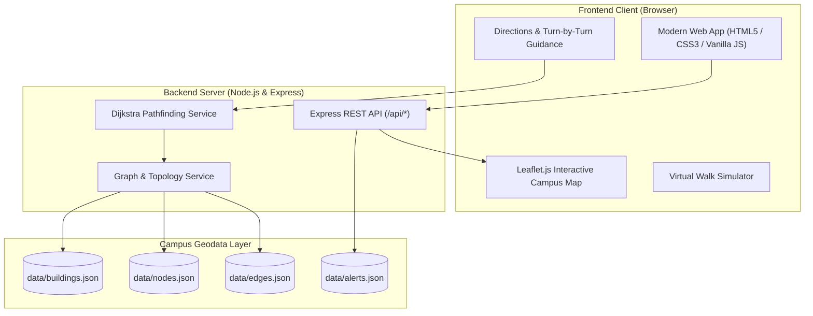

# 🧭 UniNav - Smart Campus Navigation System

A full-stack, responsive **University Campus Navigation & Indoor Wayfinding System** designed for students, faculty, staff, and visitors. Powered by a **Node.js/Express REST API** with a custom **Dijkstra Pathfinding Engine** and a modern **interactive frontend map interface**.

---

## 🌟 Key Features

### 📍 Interactive Campus Mapping
- **Realistic University Cartography**: Centered on *Apex University Campus* with complete building footprints, lawns, fountains, parking lots, and walkways.
- **Dynamic Layer Controls**: Toggle between clean CartoDB Voyager street maps and Satellite imagery.
- **Pathway Visualizer**: Inspect pedestrian walkways, vehicle roads, accessible ramps, and indoor connectors.
- **Interactive Points of Interest (POIs)**: Click any building to view opening hours, amenities, description, and multi-floor directory.

### 🚶 Multi-Modal Routing & Wayfinding
- **Dijkstra Optimal Pathfinding**: Calculates the shortest pedestrian walking distance between any two campus locations.
- **Wheelchair Accessible Mode**: Automatically avoids stairs and steep curbs, rerouting visitors through gentle ramps, elevators, and wide corridors.
- **Turn-by-Turn Guidance**: Calculates real compass bearings to give directions (*"Continue straight on Central Avenue"*, *"Bear slight right at Clock Tower Plaza"*, *"Turn left onto Engineering Promenade"*).
- **Time, Distance & Calorie Estimator**: Real-time walking time, distance in meters, and estimated calories burned.
- **Virtual Walk Simulator**: An animated walking avatar moves along the calculated path with real-time step synchronization.

### 🏢 Indoor Building & Room Directory
- **Room-Level Wayfinding**: Search and navigate directly to specific classrooms, laboratories, auditoriums, department offices, or student counters.
- **Multi-Floor Support**: Browse Ground, 1st, and 2nd floor plans for each campus block.
- **Indoor Guidance Integration**: Routes users to the building entrance and seamlessly advises on which floor and room to proceed to upon arrival.

### ⚡ Live Search & Campus Advisories
- **Instant Search with Autocomplete**: Search across buildings, room names, codes (e.g. `ADM`, `LIB`, `ENG`), and facilities.
- **Dynamic Construction Rerouting Simulator**: Simulate a pathway closure (e.g. maintenance work) and watch the routing engine immediately recalculate alternative accessible detours in real time.
- **Emergency Directory**: Quick access to 24/7 campus clinic, security control room, and shuttle bus schedules.

---

## 🏗️ Architecture & Data Flow



---

## 🚀 Quick Start Guide

### Prerequisites
- **Node.js** (v18.0 or newer) installed on your system.

### One-Click Launch (Windows)
Double-click `start.bat` in the project root directory. It will start the server and open your default browser to `http://localhost:3000`.

### Manual Launch (Terminal)
```bash
# 1. Install dependencies (already installed in workspace)
npm install

# 2. Start the navigation server
node server.js

# 3. Open your browser
# Visit: http://localhost:3000
```

---

## 📡 REST API Documentation

### 1. Health & Statistics
```http
GET /api/health
```
**Response:**
```json
{
  "status": "healthy",
  "system": "Campus Navigation System API",
  "version": "1.0.0",
  "stats": {
    "buildingsCount": 13,
    "nodesCount": 35,
    "edgesCount": 48,
    "alertsCount": 2
  }
}
```

---

### 2. Buildings Directory
```http
GET /api/buildings
GET /api/buildings?category=Academic
GET /api/buildings?q=robotics
```
Returns list of campus buildings with coordinates, polygons, entrances, floors, and amenities.

---

### 3. Unified Search
```http
GET /api/search?q=cse
```
**Response:**
```json
[
  {
    "type": "room",
    "id": "r-eng-cse1",
    "name": "CSE Software Lab 101",
    "buildingId": "b-eng",
    "buildingName": "Engineering & Technology Block",
    "subtitle": "Engineering & Technology Block (First Floor)",
    "coordinates": { "lat": 12.9745, "lng": 77.5946 },
    "color": "#8B5CF6",
    "icon": "door-open"
  }
]
```

---

### 4. Route Calculation (Dijkstra Wayfinding)
```http
POST /api/route
Content-Type: application/json

{
  "start": "n-gate-main",
  "destination": "b-lib",
  "wheelchair": false,
  "avoidClosed": true
}
```
**Response:**
```json
{
  "startNode": { "id": "n-gate-main", "name": "Main University Gate", "lat": 12.9702, "lng": 77.595 },
  "endNode": { "id": "n-lib-main", "name": "Central Library Main Entrance", "lat": 12.9731, "lng": 77.596 },
  "totalDistance": 488,
  "durationMinutes": 6,
  "caloriesBurned": 21,
  "wheelchairMode": false,
  "path": [ ... ],
  "instructions": [
    {
      "step": 1,
      "type": "depart",
      "instruction": "Start at Main University Gate, proceed along South Entrance Boulevard toward University Boulevard South",
      "distance": 89,
      "pathType": "paved_road"
    },
    {
      "step": 2,
      "type": "turn",
      "instruction": "Continue straight at University Boulevard South onto University Central Avenue",
      "distance": 111,
      "pathType": "paved_road"
    },
    ...
  ]
}
```

---

### 5. Dynamic Maintenance / Pathway Closure Simulation
```http
POST /api/edges/:id/status
Content-Type: application/json

{
  "status": "closed"
}
```
Instantly marks a pathway as closed or open. Subsequent routing requests will automatically detour around blocked edges.

---

## 📁 Project Structure

```text
campus navigation app/
├── frontend/                       # Client-side web application
│   ├── css/
│   │   └── style.css               # Design system, glassmorphism, responsive sidebar
│   ├── js/
│   │   ├── api.js                  # Adaptive REST API client wrapper
│   │   ├── app.js                  # Main controller, search, directory, modals
│   │   ├── map.js                  # Leaflet map manager, vector overlays, amenities
│   │   └── navigation.js           # Dijkstra directions, turn-by-turn guidance, simulation
│   ├── assets/                     # Campus images and icons
│   └── index.html                  # Responsive Single-Page Application interface
│
├── backend/                        # Server-side REST API & Dijkstra engine
│   ├── data/
│   │   ├── buildings.json          # 13 buildings, floor plans, room directory
│   │   ├── nodes.json              # Waypoints, building entrances, landmarks
│   │   ├── edges.json              # Pathways, accessible ramps, distances
│   │   └── alerts.json             # Live notices & dynamic closures
│   ├── src/
│   │   ├── routes/
│   │   │   └── api.js              # Express REST endpoints
│   │   └── services/
│   │       ├── graphService.js     # Campus topology, bearings, node resolver
│   │       └── pathfinding.js      # Dijkstra pathfinding & turn-by-turn engine
│   ├── package.json                # Backend dependencies (express, cors)
│   └── server.js                   # Application server & static file host (Port 3000)
│
├── start.bat                       # One-click Windows starter script
└── README.md                       # System documentation
```

---

## ♿ Accessibility & Universal Design
- Every building entrance and pathway contains a `wheelchairAccessible` boolean flag.
- When **Accessible Mode** is activated in the UI, the Dijkstra engine prunes staircases and steep paths, guiding visitors via designated wheelchair ramps, ground elevators, and paved plazas.
